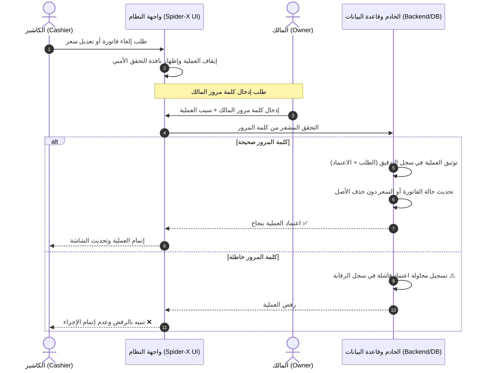

# 🕷️ SPIDER X – Gaming Center Management System
## وثيقة المواصفات الفنية — إعدادات الصلاحيات والرقابة الأمنية
**Project Specification Document: Security, Permissions & Audit Oversight**

---

## 📌 1. نظرة عامة
تحدد هذه الوثيقة المعايير الفنية والتنظيمية المعتمدة لضبط الصلاحيات، الرقابة المالية، ومنع التلاعب داخل مراكز الألعاب وصالات البلايستيشن التي تديرها منصة **SPIDER X**. تهدف المواصفات إلى الفصل الواضح بين المهام التشغيلية اليومية وبين صلاحيات الاعتماد والتدقيق المالي.

---

## 📋 2. الإعدادات المعتمدة (Approved Settings)

| الإعداد (Setting) | القرار النهائي (Approved Decision) | نطاق التطبيق والتأثير |
| :--- | :--- | :--- |
| **الموافقة على تعديل الأسعار** | **كلمة مرور المالك** | يشمل أسعار ساعات اللعب للأجهزة، وأسعار بيع منتجات الكاشير والمشروبات. |
| **الموافقة على إلغاء الفواتير** | **كلمة مرور المالك** | يشمل إلغاء فواتير الجلسات، فواتير الكاشير، وعمليات استرجاع المبيعات بعد إتمامها. |
| **مشاهدة الأرباح** | **المالك والمدير** | تقتصر شاشات الأرباح الصافية، والتقارير المالية الموسعة على المالك والمدير فقط، وتُحجب عن الكاشير. |
| **سجل حركات الموظفين** | **تسجيل كل العمليات ومحاولات الرفض** | تتبع شامل لكافة العمليات الناجحة، مع توثيق محاولات إدخال كلمة المرور الخاطئة أو المرفوضة أمنياً. |

---

## 👥 3. مصفوفة الصلاحيات (Role-Based Access Matrix)

| الوظيفة / الشاشة | الكاشير (Cashier) | المدير (Manager) | المالك (Owner) |
| :--- | :---: | :---: | :---: |
| فتح وإغلاق جلسات اللعب | ✅ | ✅ | ✅ |
| إضافة طلبات للسلة وبيع مباشر | ✅ | ✅ | ✅ |
| استلام المدفوعات وإصدار الفواتير | ✅ | ✅ | ✅ |
| فتح وإغلاق الوردية الخاصة به | ✅ | ✅ | ✅ |
| مشاهدة تقارير الأرباح الصافية | ❌ محجوب | ✅ مصرح | ✅ مصرح |
| تعديل أسعار البيع بدون موافقة | ❌ ممنوع | ❌ ممنوع | ✅ متاح بالاعتماد |
| إلغاء الفواتير المعتمدة بدون موافقة | ❌ ممنوع | ❌ ممنوع | ✅ متاح بالاعتماد |
| اعتماد عمليات التعديل والإلغاء المحمية | ❌ غير مصرح | ❌ غير مصرح | ✅ بكلمة مرور المالك |
| استعراض سجل الرقابة والتدقيق (Audit Logs) | ❌ محجوب | 👁️ استعراض | ✅ استعراض كامل وإدارة |

---

## ⚙️ 4. قواعد التنفيذ وآلية العمل (Implementation Rules & Workflow)

1. **حظر الإجراءات المنفردة:**
   الكاشير لا يمتلك أي صلاحية لتعديل أسعار المنتجات أو إلغاء الفواتير المعتمدة بمفرده.
2. **نافذة التحقق الأمني الفوري (Owner Authorization Prompt):**
   عند قيام الكاشير بالضغط على طلب "تعديل سعر" أو "إلغاء فاتورة"، يوقف النظام العملية فوراً ويعرض نافذة أمنية تطلب إدخال **كلمة مرور المالك** لإتمام الإجراء.
3. **التوثيق المزدوج للمسؤولية (Dual-Party Tracking):**
   تُسجّل في قاعدة البيانات هوية الطرفين:
   - الشخص الذي طلب العملية (`requested_by` - اسم الكاشير ومعرفه).
   - الشخص الذي وافق على العملية (`approved_by` - المالك).
   - التاريخ والوقت بالثانية (`timestamp`).
4. **شاملية سجل التدقيق والرقابة (Comprehensive Audit Trail):**
   يتم تسجيل الأحداث الآتية إجبارياً وبشكل غير قابل للتعديل:
   - إنشاء الفواتير
   - تعديل بيانات الفاتورة أو أسعارها
   - إلغاء أو استرجاع الفواتير مع توثيق سبب الإلغاء
   - فتح الجلسات، إيقافها المؤقت، واستئنافها، وإغلاقها
   - حركات الخزنة النقدية، الإيداعات، والمصروفات، وفتح وإغلاق الورديات
   - **محاولات الرفض:** تسجيل أي محاولة إدخال خاطئة لكلمة مرور المالك أو محاولة تجاوز الصلاحيات.
5. **استقلالية المدير عن الاعتماد المحمي:**
   المدير يمتلك صلاحية متابعة سير العمل ومشاهدة تقارير الأرباح والمصروفات لتسيير العمليات، لكنه **لا يحصل تلقائياً** على صلاحية اعتماد العمليات المحمية، والتي تبقى حصرية للمالك عبر كلمة مروره.
6. **سياسة عدم الحذف النهائي (Soft Cancellation Policy):**
   الفواتير المعتمدة والمدفوعة لا يتم حذف سجلها نهائياً من قاعدة البيانات (`NO HARD DELETE`)، بل يتم تحويل حالتها إلى `cancelled` أو `refunded` مع بقاء أصل السجل محفوظاً لغايات التدقيق المحاسبي.

---

## 🔄 5. مخطط تسلسل اعتماد الإلغاء وتعديل الأسعار



---

## 🗄️ 6. مواصفات هيكل سجل التدقيق المقترح (Audit Log Schema)

```sql
CREATE TABLE IF NOT EXISTS `system_audit_trail` (
  `id` BIGINT AUTO_INCREMENT PRIMARY KEY,
  `event_type` ENUM('invoice_create', 'invoice_update', 'invoice_cancel', 'price_override', 'session_open', 'session_close', 'shift_action', 'cash_drawer', 'auth_failure') NOT NULL,
  `requested_by_id` VARCHAR(50) NOT NULL,
  `requested_by_name` VARCHAR(100) NOT NULL,
  `approved_by_id` VARCHAR(50) DEFAULT NULL,
  `approved_by_name` VARCHAR(100) DEFAULT NULL,
  `entity_type` VARCHAR(50) NOT NULL, -- 'invoice', 'session', 'product', 'shift'
  `entity_id` VARCHAR(50) NOT NULL,
  `previous_state` JSON DEFAULT NULL,
  `new_state` JSON DEFAULT NULL,
  `reason` TEXT DEFAULT NULL,
  `status` ENUM('approved', 'rejected', 'failed') NOT NULL DEFAULT 'approved',
  `ip_address` VARCHAR(45) DEFAULT '127.0.0.1',
  `created_at` DATETIME DEFAULT CURRENT_TIMESTAMP
) ENGINE=InnoDB DEFAULT CHARSET=utf8mb4 COLLATE=utf8mb4_unicode_ci;
```

---

## 🔒 7. الملاحظة الأمنية ومعايير التشفير
- تُخزّن كلمة مرور المالك حصراً بصيغة مشفّرة ومُجزّأة آمنة باستخدام خوارزميات التجزئة القياسية المتطورة (`Argon2id` أو `Bcrypt` بمعامل تكلفة عالي وملح عشوائي `Cryptographic Salt`).
- يُحظر كلياً إرسال أو تخزين كلمة المرور بنص صريح (`Plaintext`)، كما يُحظر تضمينها أو تخزينها في المتصفح المحلي `localStorage` أو إظهارها في شاشات الكاشير أو المدير.
- تُطبّق سياسة تقييد محاولات الإدخال الخاطئة (`Rate Limiting / Lockout`) لمنع هجمات التخمين (`Brute-Force`).

---

## 📑 8. حالة الاعتماد الرسمية

> [!NOTE]
> **ملاحظة توثيقية:** تم اعتماد هذه المتطلبات والضوابط رسمياً ضمن **مواصفات مشروع SPIDER X – Gaming Center Management System**، ويُعتمد هذا المستند كمرجع أساسي لمراحل التطوير البرمجي القادمة.

